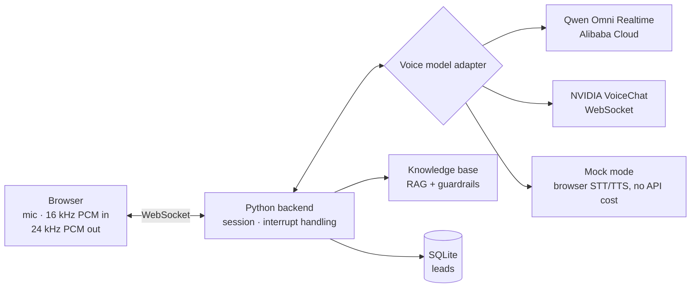

# Morris Park AI Voice Guide

**A real-time, interruptible voice agent that answers enquiries for a commercial property site and captures sales leads.** Visitors talk to it in the browser; it answers from a curated knowledge base, refuses to invent prices or availability, and collects viewing requests one field at a time.

Built as a client demo for Morris Park, a business park in Glasgow; the knowledge base uses the site's publicly listed information.

<!-- Add a 30–60 second screen recording of a conversation here -->

## What it does

- **Full-duplex voice conversation** — the visitor can interrupt mid-answer; the agent stops speaking and responds to the new question
- **Grounded answers** — each transcript is matched against a local knowledge base (core facts, availability, FAQ) and the relevant context is injected into the live conversation
- **Guardrails** — explicit rules stop the agent inventing rent, deposits, lease terms or availability; uncertain questions are handed to the human team
- **Intent detection** — lightweight rules spot pricing, availability and booking intent and steer the conversation
- **Lead capture** — when a visitor wants a viewing or a call back, the agent asks for name, contact, space type and preferred time one at a time and stores the lead in SQLite
- **Embeddable** — runs as a full page or an `<iframe>` widget on any HTTPS site

## Architecture



The voice model sits behind a small adapter interface (`start`, `send_audio`, `send_control`, `close`), so the same agent logic runs on Qwen realtime, NVIDIA VoiceChat or a zero-cost mock — the model can be swapped without touching the conversation, RAG or lead-capture code. Retrieval runs as an async sidecar so it never blocks the audio stream.

## Project structure

```text
backend/
  server.py           # HTTP + WebSocket server, session and interrupt handling
  cloud_server.py     # FastAPI WebSocket bridge for Railway
  morris/
    voicechat.py      # model adapters: mock, NVIDIA WebSocket, Qwen realtime
    knowledge.py      # knowledge base search + persona prompt
    intent.py         # intent rules (pricing, availability, booking)
    lead_store.py     # SQLite lead capture
frontend/static/      # browser client and embeddable widget
knowledge/            # core facts, availability, guardrails, FAQ
```

## Tech stack

Python · asyncio · WebSockets · FastAPI · Qwen Omni Realtime (DashScope) · NVIDIA VoiceChat · SQLite · vanilla JS Web Audio · Vercel (frontend) · Railway (backend)

## Run locally

```bash
cp .env.example .env      # set DEMO_PASSWORD; leave VOICECHAT_BACKEND=mock to start
pip install -r requirements.txt
python3 backend/server.py
```

Open http://localhost:5173. Mock mode uses browser speech recognition and synthesis, so the UI, retrieval, interruption and lead capture can be tested without API credits.

To use a real voice model, set `VOICECHAT_BACKEND=qwen-realtime` (with `DASHSCOPE_API_KEY` and the `QWEN_REALTIME_*` values) or `VOICECHAT_BACKEND=nvidia-ws` (with the `NVIDIA_*` values) in `.env`. `python3 backend/test_qwen_realtime.py` checks model access first.

Remote demos need HTTPS for microphone access. For an always-on demo, deploy the backend to Railway (`railway.json`) and point the Vercel frontend at it with `PUBLIC_WS_URL=wss://<your-railway-domain>/ws`.

## Try these

- "Do you have parking?"
- "What spaces are available?"
- "How much is it?" — the agent will not make up a price
- "I want to book a viewing" — starts lead capture
- Interrupt it while it is speaking

## Author

Designed and built by **Dong Wang**.
